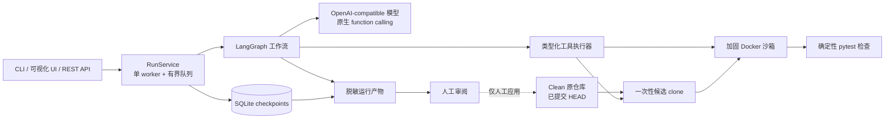

# Repo Maintainer Agent

[English](README.md) | [演示流程](docs/DEMO.md) | [OSS 评测证据](docs/OSS_EVALUATION_V1.md) | [详细用户说明](docs/USER_GUIDE.zh-CN.md) | [评测协议](benchmarks/README.md)

Repo Maintainer Agent 把自然语言 Bug 描述转换为可审阅、经过验证的本地 Git
仓库补丁。它使用 OpenAI-compatible 模型生成计划，等待人工批准，只在一次性候选
clone 中修改代码，再用加固的 Docker 容器验证结果，最后交付持久化产物供人工
检查。它不会把补丁自动应用、提交或推送到原仓库。

项目包含 Typer CLI、本机可视化工作台、带认证的 FastAPI 服务、可恢复的
LangGraph 工作流、加固的 Python/pytest 沙箱和冻结的 Python 验收集。早期
Python/Java 混合实验仅作为只读历史证据保留在 `benchmarks/results/v1`；其中脱敏
后的 `results.jsonl` 仍是该历史实验的唯一数据源。

**Python-only v1 实测证据（2026-10-11）：** 使用 DeepSeek 官方
`deepseek-v4-pro` 对三个冻结的公开 issue 裁剪快照执行一次且不重跑的 trial，
3/3 均完成、零超时，独立评分解决 **1/3**。成功题首补通过 public、hidden、
回归生命周期和 policy 检查，三题均未超过 30,000 token。完整口径、失败原因与
可核查案例见 [OSS 评测事实报告](docs/OSS_EVALUATION_V1.md)；该结果不是完整上游
仓库评测，也不外推为通用成功率。

## 核心能力

- 接收一个 clean、已有提交的 Git 仓库和自然语言维护任务。
- 构建有界仓库地图，并按阶段提供最小类型化工具面；持久化修改阶段只先提供
  `read_files`，读取成功后仅提供写入完整文件内容的 `write_files`，不暴露 shell
  或直接检查命令。
- 生成结构化修改计划；除非显式选择自动批准，否则等待人工审批。
- 只在当前运行拥有的候选 clone 中应用模型补丁，并在 Docker 中运行确定性的
  `pytest` 检查。
- 验证失败最多修复一次；独立审查固定为一次模型响应，拒绝后保留候选并终止。
- 模型预算按阶段固定且不可借用：规划 4,000 token，实现与修复合计 23,500，
  审查 2,500，总上限 30,000。
  当前 DeepSeek durable 工作流要求 provider 返回完整 usage，缺失时 fail closed；
  不返回 usage 的 loopback provider 与归档 baseline 评测器仅属开发/历史入口，
  不在此 v1 硬上限承诺范围内。
- 在 SQLite 中记录每个工作流边界；中断后可恢复，且不会主动重复已完成并已记录
  的副作用。
- 生成 `patch.diff`、`report.md`、`run.json`、`trace.jsonl` 和有界测试日志。

显式选择的 `demo` provider 无需 Key，但仅支持只读检查。模型配置缺失或接口不
兼容时会明确失败，不会以伪造模型输出降级运行。

## 架构



固定维护路径如下：

```text
prepare -> baseline_check -> inspect_and_plan -> approval -> implement
        -> verify -> repair（最多 1 次）-> review -> finalize
```

规划阶段只读，模型不能跳过确定性验证。最终状态 `succeeded` 表示工作流完成了
已配置的检查与审查，不等于独立 benchmark 判定通过，也不能替代人工接受补丁。

## 支持的仓库类型

待维护仓库必须是 clean Git worktree，且至少有一次提交。候选工作区只复制已提交
内容。

| Profile | 支持范围 |
|---|---|
| Python | Python 3.11、`pytest`、单个根项目；可从根目录 `requirements.txt` 或 PEP 621 元数据执行需显式授权的依赖 bootstrap |

当前 v1 产品只接受这一 Python/pytest profile。Java/Maven fixture 与镜像元数据仅为
复现早期混合评测证据而保留，不在 UI 中提供。混合语言布局、Git submodule、Git
LFS、仓库 symlink/reparse point 以及 dirty worktree 会被拒绝。仓库超出范围时，
以 policy 错误和 check 产物中的具体原因作为诊断依据。

当前 v1 的完整文件编辑合同有意保持窄范围：已有文件只有在完整内容为 UTF-8、仅用
LF 换行、不超过 200 个逻辑行且不超过 16 KiB 时才能编辑。`read_files` 每次接受
1-4 个互不重复的已有路径，完整批次输出也不得超过 16 KiB；超限时会 fail closed，
不会返回可继续编辑的截断前缀。新建或替换内容同样受每文件 200 行、16 KiB 限制。
仓库可以包含更大、CRLF 或非文本文件，但当前 v1 工作流不能修改它们。

## 环境要求

仓库提供的环境脚本面向 Windows、PowerShell 和 Docker Desktop：

- Windows、WSL2、Docker Desktop Linux containers
- PowerShell 5.1 或更高版本
- 宿主 Python 3.11 或更高版本、Git
- Docker 至少可用 4 GB 内存

Python 包和 CI 也可在带兼容 Docker Engine 的 Linux 上运行。Docker Desktop 保持
按需启动；脚本不会修改 `.wslconfig`、registry mirror、代理设置，也不会执行全局
Docker 清理。

## 安装与环境验收

在项目根目录打开 PowerShell：

```powershell
./scripts/start-docker.ps1
./scripts/build-sandboxes.ps1
./scripts/verify-docker.ps1
py -3.11 -m pip install -e ".[dev]"
python -m pytest
python ./scripts/smoke-day2.py
```

当前产品使用 `repo-agent-python:0.1` 沙箱镜像，其中包含 Python 3.11、pytest、
Git 和 ripgrep。

| 沙箱 | 固定基础镜像 |
|---|---|
| Python | `python:3.11.16-slim-bookworm@sha256:528257d48c1da0dcecc2e725d1ae34498d60c965f1241e39cd6a85a8859bdf84` |

该 Dockerfile 固定了基础镜像 digest。本机构建元数据记录在
`docker/image-lock.json`；CI 验证 Dockerfile 与运行时安全合同，不依赖某台机器
特有的最终 image ID。旧 Maven Dockerfile 仅为历史 fixture 验证保留，其 lock
条目只由下方显式 opt-in 路径生成。

两个脚本默认都只构建、验收 Python 镜像。只有复现早期混合套件证据时，才显式启用
保留的 Maven 镜像：

```powershell
./scripts/build-sandboxes.ps1 -IncludeLegacyMaven
./scripts/verify-docker.ps1 -IncludeLegacyMaven
```

`build-sandboxes.ps1` 会刷新 `docker/image-lock.json` 中与本机相关的 image ID；
只有指定开关时才包含 Maven 条目。提交由此产生的变更前应单独审查。

## 无 Key 快速体验

先对本仓库运行只读检查：

```powershell
repo-agent run `
  --repo . `
  --task "检查仓库状态和 TODO 标记" `
  --provider demo `
  --format json
```

也可以启动可视化工作台：

```powershell
repo-agent serve --repo . --open
```

浏览器未自动打开时访问 `http://127.0.0.1:8765/`，选择 **Read-only demo**。
服务启动时已经固定仓库路径和沙箱镜像，网页不能提交其他宿主路径或任意镜像。

## 配置模型

模型客户端要求 Responses API 或 Chat Completions 提供原生 function calling。
请通过组织认可的密钥注入方式设置以下进程环境变量：

```text
REPO_AGENT_API_KEY
REPO_AGENT_BASE_URL
REPO_AGENT_MODEL
```

不要把 Key 提交进仓库、写进任务文件、放在命令行参数中，或挂载到沙箱。真实任务
前先检查连通性：

```powershell
repo-agent doctor --allow-remote-model --format json
```

非 loopback 模型地址必须使用 HTTPS，并要求显式传入 `--allow-remote-model`。
这是数据出站授权：任务文本和工具为完成任务选取的代码片段可能被发送给所配置的
模型服务。

### 保存 Windows DeepSeek 配置

对于 DeepSeek 官方 API `https://api.deepseek.com`，辅助脚本可以发现可用模型、
执行 doctor 探针，并把 Key、Base URL、模型作为一个整体使用 Windows DPAPI
CurrentUser 加密保存。当前配置模型为 `deepseek-v4-pro`：

```powershell
./scripts/start-relay.ps1 -Reconfigure -ConfigureOnly -Model deepseek-v4-pro
./scripts/start-relay.ps1 -Repository D:\path\to\clean-repository -OpenBrowser
```

配置保存到 `%LOCALAPPDATA%\RepoMaintainerAgent\config\relay.json`，以后启动无需再次
输入。使用 `-Verify` 可重新执行一次会产生少量调用的握手；使用
`-Reconfigure -ConfigureOnly` 轮换 Key 或模型。辅助脚本启动的 UI 退出后，脚本会
恢复进程环境。DPAPI 保护当前 Windows 用户的静态配置，但不能抵御已经以同一用户
运行的恶意程序或管理员。

## 运行维护任务

当前进程已经具备模型环境变量时：

```powershell
repo-agent run `
  --repo D:\path\to\clean-repository `
  --task "修复解析器边界错误并增加回归测试" `
  --allow-remote-model
```

也可从 UTF-8 文件读取任务并自动批准计划：

```powershell
repo-agent run `
  --repo D:\path\to\clean-repository `
  --task-file .\issue.txt `
  --yes `
  --allow-remote-model `
  --format json
```

仅在审核过仓库声明的依赖后增加 `--allow-bootstrap`。bootstrap 使用注册且有界的
固定命令和 `bridge` 网络；后续验证在另一个 `network=none` 容器中运行。

持久化任务管理命令：

```powershell
repo-agent show RUN_ID --format json
repo-agent resume RUN_ID --approve --reason "已审核计划"
repo-agent resume RUN_ID
repo-agent cancel RUN_ID
```

不带 decision 的 `resume` 只用于 `interrupted` 状态。一个 data directory 同时只能
被一个活跃 `RunService` 拥有；UI 或 API 运行时，应通过该服务审批、恢复、取消。
只读的 `show` 命令仍可使用。

## 可视化工作台与 REST API

本机工作台展示环境就绪状态、仓库身份、安全策略、计划审批、检查结果、metrics、
实时活动日志以及可下载产物：

```powershell
repo-agent serve --repo D:\path\to\clean-repository --port 8765 --open
```

需要程序化接入时，启动带 Bearer 认证的 FastAPI 服务：

```powershell
$env:REPO_AGENT_BEARER_TOKEN = "replace-with-a-local-secret"
$repoRoot = (Get-Location).Path
$allowedRoot = Split-Path -Parent $repoRoot
repo-agent serve --api `
  --repo $repoRoot `
  --allowed-root $allowedRoot `
  --host 127.0.0.1 `
  --port 8080
```

除 `/healthz` 和 `/readyz` 外，所有 run 与 artifact 路由都要求
`Authorization: Bearer ...`。

| 方法与路径 | 用途 |
|---|---|
| `POST /v1/runs` | 将任务加入队列并返回 ID |
| `GET /v1/runs?status=&limit=` | 查询近期任务及排队位置 |
| `GET /v1/service/status` | 查询队列深度、容量和活跃 worker |
| `GET /v1/runs/{id}` | 查询状态、计划、检查、metrics 和产物链接 |
| `GET /v1/runs/{id}/events` | 通过 `Last-Event-ID` 可续传的 SSE 获取实时进度 |
| `POST /v1/runs/{id}/decision` | 批准或拒绝计划 |
| `POST /v1/runs/{id}/resume` | 恢复中断任务 |
| `POST /v1/runs/{id}/cancel` | 请求取消并回收活跃沙箱 |
| `GET /v1/runs/{id}/artifacts/{kind}` | 下载固定运行产物 |

API 中的仓库路径必须是绝对路径，并位于配置的 `--allowed-root` 之下。

调度器固定一次只运行一个工作流，最多保留四个等待任务；取消等待任务会立即释放
队列容量。两套 HTTP 服务都把实时 SSE 连接限制为四个。可视化 UI 使用 SQLite
事件序号作为重连游标；浏览器不支持 `EventSource` 时自动降级为 900 ms 轮询。
SSE 只发送有界、白名单化的阶段、节点、工具计数和模型 usage 等活动摘要，不发送
原始事件 detail 或检查输出；完整日志仍通过已脱敏的产物下载。REST API 客户端必须
在请求头中携带 Bearer token，不能把 token 放进 URL。

## 运行状态与产物

Windows 默认把持久化数据保存到 `%LOCALAPPDATA%\repo-agent`，可用 `--data-dir` 或
`REPO_AGENT_DATA_DIR` 覆盖。每次运行拥有：

| 产物 | 内容 |
|---|---|
| `patch.diff` | 供人工审阅和应用的候选 unified diff |
| `report.md` | 任务、批准计划、检查与风险摘要 |
| `run.json` | 结构化运行状态与 metrics |
| `trace.jsonl` | 追加式、已脱敏的工作流事件 |
| `checks/*.log` | 有界的 baseline 和 verify 输出 |

公开状态包括 `queued`、`planning`、`awaiting_approval`、`running`、
`interrupted`、`succeeded`、`unverified`、`failed`、`cancelled`、
`policy_denied` 和 `rejected`。

## 安全边界

每个验证容器使用同一安全合同：

```text
--init --pull never --restart no
--network none --read-only --user 10001:10001
--cpus 2 --memory 4g --memory-swap 4g --pids-limit 256
--cap-drop ALL --security-opt no-new-privileges
--tmpfs /tmp:rw,nosuid,nodev,size=256m,mode=1777
```

其他边界包括：

- 原仓库永远不会以读写方式挂载，也不会被自动 apply、commit 或 push。
- 模型没有 shell、任意命令、Git push、宿主网络、Docker socket、SSH 或凭据工具。
- 绝对路径、路径穿越、`.git`、疑似凭据路径、symlink/reparse 逃逸、hardlink
  目标、二进制补丁、rename、submodule 和 mode change 均被拒绝。
- 宿主 HOME、SSH 配置、模型凭据、Docker socket 不会挂载进工具或验证容器。
- 日志和结构化产物有大小限制并进行脱敏；`patch.diff` 为保持可应用性按原字节
  保存，若命中已配置密钥或高置信凭据格式则直接拒绝持久化，不会改写 diff。
  容器按 run 命名/打标签，仅按精确 ID 回收，不运行全局 prune。

模型服务本身仍是外部信任边界。只有当仓库允许把相关代码和任务文本发送给该服务
时，才应授权远程模型。

## 旧版混合评测实测结果（只读）

以下数字属于已退役的 Python/Java 混合实验，不是当前 Python-only 发布门禁。其
fixture、矩阵和已发布文件均作为不可变审计证据保留，当前验收不会改写这些数字。

锁定的 44-job 评测已于 2026-09-12（UTC+8）使用 `gpt-5.6-sol` 完成。下列已发布
v1 表格和汇总统计均可从 [`results.jsonl`](benchmarks/results/v1/results.jsonl)
重新计算；该文件
SHA-256 为
`1f083cdf6ce1630ec50da47cadf3b16a7e628c09c23f10e697bc407549579761`。
中转站 token 单价未经独立核实，因此不报告费用。

主比较只使用 trial 1：

| Variant | 解决数 | Python | Java | Agent p50 | Agent p95 |
|---|---:|---:|---:|---:|---:|
| `baseline` | 10/12 | 6/6 | 4/6 | 72.1 秒 | 370.4 秒 |
| `no-review` | 3/12 | 3/6 | 0/6 | 347.4 秒 | 693.6 秒 |
| `full` | 1/12 | 1/6 | 0/6 | 238.1 秒 | 633.0 秒 |

这是完整架构在该锁定评测集上的负面结果。`full` 未达到预声明的 8/12 总门槛，
Python 和 Java 也未分别达到 4/6；它比 `baseline` 少解决 9 题，比
`no-review` 少解决 2 题。因此，本次结果不支持“完整架构提升成功率”或“独立
review 带来收益”这两个正向结论。

不可变的 v1 scorer 没有识别 trial-1 `full` 中 `py-bugfix-005` 的 pytest
`SUBFAILED` 输出。对保留的 scoring evidence 应用修正后的归因规则，该结果等价于
总计 2/12、Python 2/6；这些修正数字不会回写不可变 JSONL，且仍未达到任一发布
门槛。详情见 [`benchmarks/ERRATA.md`](benchmarks/ERRATA.md)；v1 的
三个发布结果文件及其摘要值均未改写。

全部 44 次运行均完成评测，其中 14 次解决任务。Agent 延迟为 p50 120.5 秒、
p95 641.8 秒，未达到 p95 不超过 8 分钟的目标。30 个失败包括 29 个
`budget_exceeded` 和 1 个 `regression_not_reproduced`；没有运行触发 20 分钟硬
超时。16/44 次运行成功恢复回归测试，469 次工具调用中有 118 次返回错误
（25.16%）。完整 usage 记录为 1,317,446 tokens：1,222,140 input（其中
54,656 cached input）和 95,306 output。费用保持 `null`，
`price_source=unavailable`。

四个 `full` 重复任务的结果分别为：`py-bugfix-003` 为 0/3、
`py-bugfix-004` 为 1/3、`java-bugfix-003` 为 0/3、`java-bugfix-006` 为
0/3。三个任务是结果一致的失败，一个任务结果不一致，没有任务表现出稳定成功。
派生汇总和失败任务清单见
[`report.json`](benchmarks/results/v1/report.json) 与
[`failure-analysis.json`](benchmarks/results/v1/failure-analysis.json)。这些实测
只描述当前模型、预算和锁定评测集，不能外推到其他仓库。

## 当前 Python 验收

当前冻结套件 ID 为 `repo-agent-python-bugfix-v1`，精确选择
`py-bugfix-001` 至 `py-bugfix-006` 六题。候选 Agent 只能看到带 Bug 的 setup、
公开测试和 `issue.md`；独立 scorer 不向 Agent 暴露 `hidden_tests`、`gold.patch`
或预期失败签名。不能直接用工作流 `succeeded` 判断题目通过。

正式运行前只使用 4 个非正式 development fixture 调优。已保存 Windows 中转站
配置时，以下受限入口会运行固定的四题 `full` 命令，并写入新的忽略目录：

```powershell
./scripts/start-relay.ps1 -Evaluate
```

仅当至少解决 3/4、四项任务均未超预算且
`actionable_tool_error_rate <= 5%` 时，该入口才以成功状态退出。

为补充可用于简历复核的真实项目证据，非正式套件
`repo-agent-python-oss-v1` 冻结了 PySnooper #2、HTTPie #235 和 The Fuck #271
三个公开回归。每题保留精确上游生产文件、许可证与独立编写的回归测试。这是经过
裁剪的 source snapshot，不等同于完整上游仓库，也不宣称是无污染 holdout。先在
不调用模型的情况下验证三题生命周期并检查 single 模式合同：

```powershell
python ./benchmarks/tasks/python/oss/validate.py
repo-agent eval --benchmark-dir ./benchmarks/tasks/python/oss --variant full --format json
```

在源码 commit `394fb21e` 上完成的单次冻结 trial 中，3/3 任务均完成、解决 1/3，
零超时、零预算失败；唯一成功题为首补通过，两个失败候选均未在有界 repair 后通过。
三题合计使用 43,132 tokens，中位耗时 437.668 秒，p95 为 546.199 秒。完整脱敏
证据与失败分析见 [OSS 评测事实报告](docs/OSS_EVALUATION_V1.md)。观察结果后未重跑。

冻结代码、prompt、模型和预算后，受限入口只运行这 6 个 Python 任务的 `full`
trial 1：

```powershell
./scripts/start-relay.ps1 -FormalEvaluate
```

只有固定 6/6 任务全部完成、至少解决 4/6、每题 usage 完整且不超过 30,000
token、无超时或预算失败且 p95 不超过 480 秒时才成功。该结果标记为 Python v1
regression acceptance，不是新的 holdout，也不会运行或改写旧 44-job matrix 与
`benchmarks/results/v1`。

先验证当前 6 个 Python fixture 的完整生命周期，再仅审计旧混合 fixture 的结构与
内容锁：

```powershell
python ./benchmarks/tasks/python/bugfix/validate.py
python ./benchmarks/validate.py --structure-only
```

使用保留的 Day 6 探针运行默认 Python-only 离线 Docker/安全验收：

```powershell
python ./scripts/smoke-day6.py
```

若要追加旧 Maven 兼容 case，先构建旧镜像，再运行
`python ./scripts/smoke-day6.py --include-legacy-maven`。这些 case 不会把当前发布的
Agent 或 UI 扩展到 Python 以外。

已退役的混合套件 matrix、canary、shard 与 merge 协议仅在
[benchmarks/README.md](benchmarks/README.md) 中作为审计资料保留。不要将其作为
当前发布门禁重跑，也不要覆盖其中三个已发布的 v1 文件。

## 开发与 CI 检查

运行和 CI 相同的质量门禁：

```powershell
ruff check src tests scripts benchmarks
mypy src/repo_agent
python -m pytest --cov=repo_agent --cov-report=term-missing --cov-fail-under=80
python ./benchmarks/validate.py --structure-only
python ./benchmarks/tasks/python/development/validate.py --structure-only
python ./benchmarks/tasks/python/bugfix/validate.py
python ./benchmarks/tasks/python/oss/validate.py
```

以下真实容器 smoke 默认都只运行 Python case，只依赖当前 Python 镜像：

```powershell
python ./scripts/smoke-day1.py
python ./scripts/smoke-day2.py
python ./scripts/smoke-day3.py
python ./scripts/smoke-day6.py
```

如需复现旧 Maven 兼容 case，应显式构建、验收该镜像，并为适用探针增加开关：

```powershell
./scripts/build-sandboxes.ps1 -IncludeLegacyMaven
./scripts/verify-docker.ps1 -IncludeLegacyMaven
python ./scripts/smoke-day1.py --include-legacy-maven
python ./scripts/smoke-day3.py --include-legacy-maven
python ./scripts/smoke-day6.py --include-legacy-maven
```

完整演示流程见 [docs/DEMO.md](docs/DEMO.md)，更细的操作说明见
[docs/USER_GUIDE.zh-CN.md](docs/USER_GUIDE.zh-CN.md)，故障注入与边界测试矩阵见
[docs/EXTREME_TESTING.zh-CN.md](docs/EXTREME_TESTING.zh-CN.md)。

## 许可证

项目采用 [MIT License](LICENSE)。
